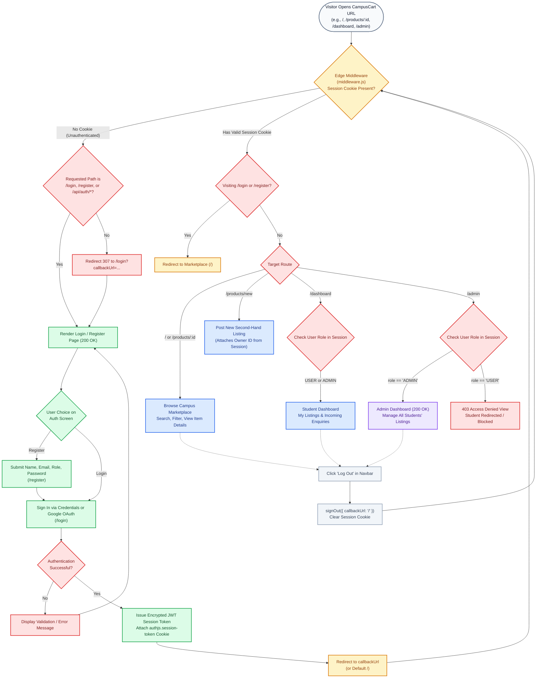
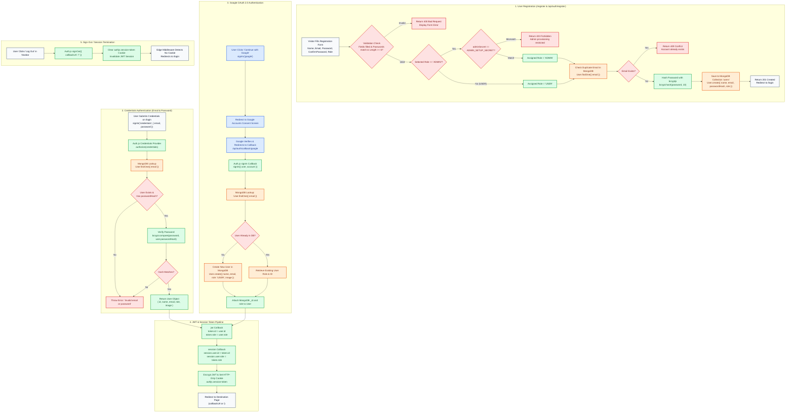
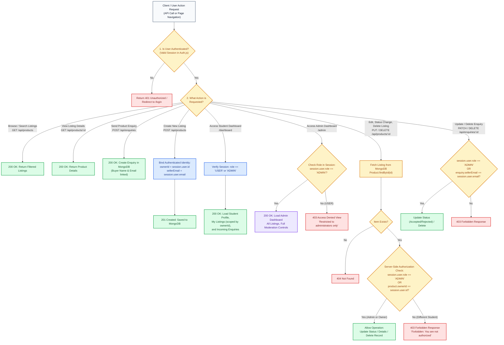
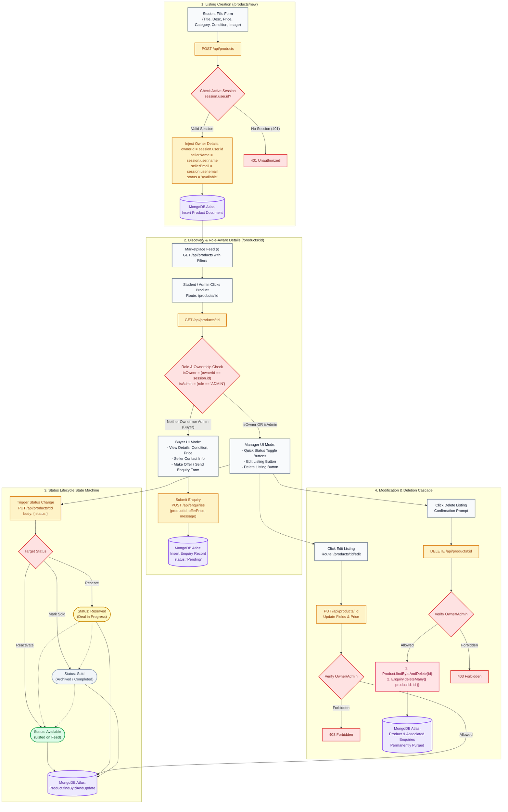
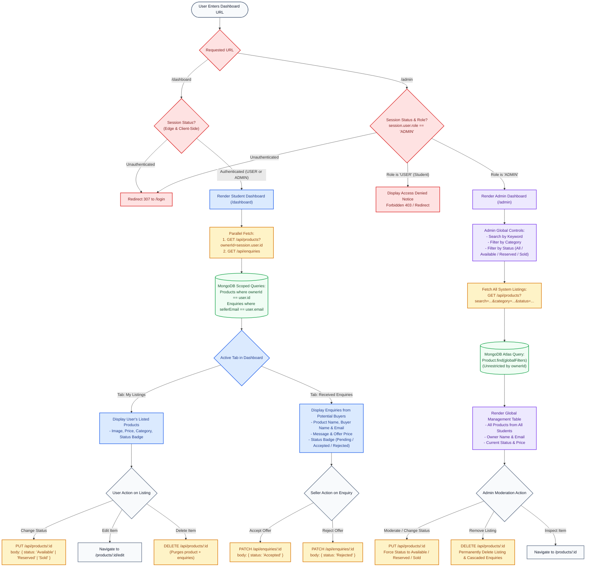
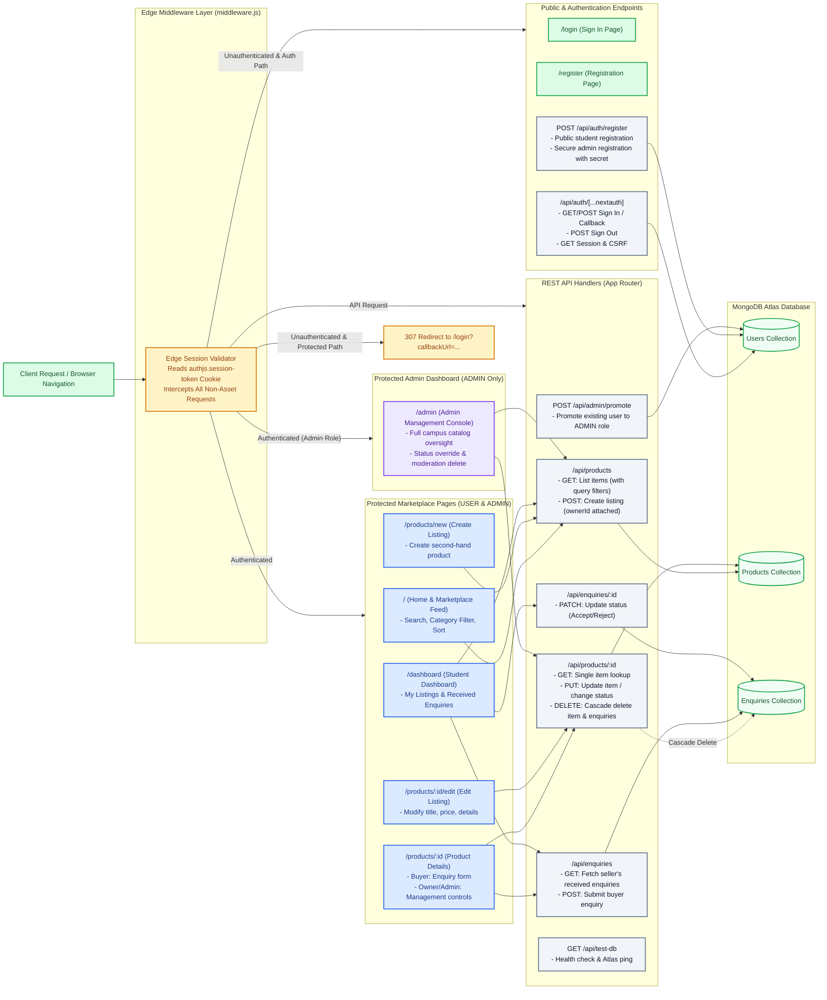
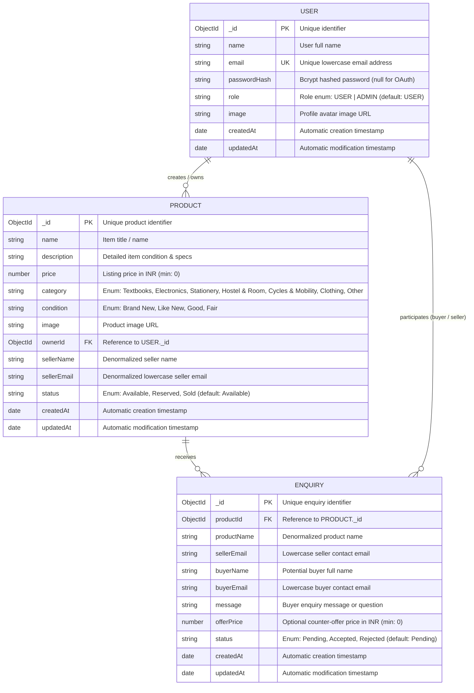

# CampusCart: Architecture, Flowcharts & System Design Specification

Welcome to the architectural documentation for **CampusCart**, a full-stack peer-to-peer second-hand marketplace designed specifically for college campuses. CampusCart empowers students to securely buy, sell, and negotiate on pre-owned academic and hostel goods (textbooks, electronics, mobility, dorm essentials) with strict identity verification, role-based access control (RBAC), and edge-level route protection.

---

## 1. System Overview & Technology Stack

| Layer | Technology | Purpose / Architectural Role |
| :--- | :--- | :--- |
| **Framework** | Next.js 16 (App Router) | Server-rendered React components, client views, and unified API route handlers |
| **Runtime & Language** | Node.js & React 19 | Modern declarative UI, hooks, and server-side streaming |
| **Authentication** | Auth.js v5 (`next-auth@beta`) | Credentials authentication, Google OAuth 2.0, encrypted JWT session tokens |
| **Security & Cryptography**| `bcryptjs` (Salt factor 10) | One-way hashing of passwords; administrative provisioning gating |
| **Database & ODM** | MongoDB Atlas & Mongoose 9 | Cloud document database with validated Schemas, enum constraints, and indexing |
| **Edge Interceptor** | Next.js Edge Middleware | Global session inspection, unauthenticated redirect handling, and URL sanitization |
| **Styling** | Tailwind CSS | Responsive, accessible UI with atomic design tokens |

---

## 2. Master Navigation & Edge Security Flowchart

The following diagram illustrates how incoming traffic is intercepted at the Next.js Edge layer. Visitors cannot reach marketplace listings, search filters, or dashboards without an active session token.



### Key Architectural Highlights:
1. **Zero Unauthenticated Leaks:** Every request passing into Next.js routes is intercepted in `middleware.js`. Unauthenticated attempts to access `/`, `/products/*`, `/dashboard`, or `/admin` trigger a HTTP 307 redirect with a preserved `callbackUrl`.
2. **Infinite Loop Prevention:** Paths starting with `/login`, `/register`, `/api/auth/`, and static assets (`/_next/static`, `/_next/image`, `favicon.ico`) bypass redirection.
3. **Session Re-entry Guard:** If an already authenticated student opens `/login` or `/register`, the Edge Middleware immediately forwards them to `/` to avoid redundant logins.

---

## 3. Authentication Engine (Dual Provider Architecture)

CampusCart supports two sign-in methods: **Credentials (Email/Password)** and **Google OAuth 2.0**. Administrative creation is guarded by a cryptographic administrative secret key.



### Key Security Safeguards:
- **Restricted Admin Provisioning:** The public registration form allows users to select `Role: ADMIN`, but the server validates `adminSecret === process.env.ADMIN_SETUP_SECRET`. Any unauthorized submission immediately receives an HTTP `403 Forbidden` response.
- **Bcrypt Salt Rounds:** All passwords are run through `bcryptjs` with 10 salt rounds before persistence. Plaintext passwords are never logged, stored, or exposed.
- **JWT Enrichment:** In `lib/auth.js`, the `jwt` and `session` callbacks explicitly preserve `user.id` and `user.role`, ensuring client and server components have access to authorization data without re-querying the database on every micro-interaction.

---

## 4. Role-Based Access Control (RBAC) & Authorization Logic

Authorization rules are enforced **both at the UI level (conditional element rendering) and strictly on the server (API route handlers)**.



### RBAC Permission Matrix:
| Capability / Route | Unauthenticated | Student (`USER`) | Administrator (`ADMIN`) | Enforcement Layer |
| :--- | :---: | :---: | :---: | :--- |
| **View Marketplace (`/`)** | Redirect 307 | Allowed | Allowed | Edge Middleware |
| **View Item Details (`/products/:id`)** | Redirect 307 | Allowed | Allowed | Edge Middleware |
| **Create Listing (`POST /api/products`)** | 401 | Allowed (`ownerId` bound) | Allowed (`ownerId` bound) | API Handler |
| **Edit/Delete Own Listing** | 401 | Allowed | Allowed | API Handler & UI |
| **Edit/Delete Another's Listing** | 401 | **403 Forbidden** | Allowed (Moderation) | API Handler & UI |
| **Send Enquiry on Item** | 401 | Allowed (Buyer) | Allowed (Buyer) | API Handler & UI |
| **Manage Received Enquiries** | 401 | Allowed (Seller Only) | Allowed (Admin Override)| API Handler & UI |
| **Access Admin Panel (`/admin`)** | Redirect 307 | **403 Forbidden** | Allowed | Middleware & UI Guard |

---

## 5. Listing Lifecycle & Cascading Deletion Flowchart

A product in CampusCart progresses through three primary states: **Available**, **Reserved**, and **Sold**. When an item is deleted, the database automatically cascades deletions to avoid orphan enquiry records.



---

## 6. Dual Dashboards: Student Portal vs Admin Console

CampusCart features two dedicated management interfaces tailored to user roles.



---

## 7. Complete System Route Tree & Interactivity Map

The following map captures all App Router pages, REST API route handlers, Edge Middleware guards, and MongoDB Atlas database collections.



---

## 8. Database Entity-Relationship (ER) Model

The database is structured in MongoDB Atlas using Mongoose ODM with relational references (`ObjectId` / `ref`) and timestamps.



---

## 9. Comprehensive Route & API Matrix

| Route / Endpoint | HTTP Method | Accessibility | Auth Layer | Request Payload / Params | Return Data / Status |
| :--- | :---: | :---: | :---: | :--- | :--- |
| `/login` | `GET` | Public | Edge Bypass | `?callbackUrl=...` | Render Sign-In Form (200) |
| `/register` | `GET` | Public | Edge Bypass | None | Render Register Form (200) |
| `/` | `GET` | Protected | Edge Middleware | Search/Filter query params | Render Marketplace Feed (200) |
| `/products/[id]` | `GET` | Protected | Edge Middleware | `id` route parameter | Render Product Details (200) |
| `/products/new` | `GET` | Protected | Edge Middleware | None | Render Create Listing Form (200) |
| `/products/[id]/edit` | `GET` | Protected | Edge Middleware | `id` route parameter | Render Edit Listing Form (200) |
| `/dashboard` | `GET` | Protected | Edge Middleware | None | Render Student Dashboard (200) |
| `/admin` | `GET` | ADMIN Only | Edge & Client Guard | None | Render Admin Console (200) / 403 |
| `/api/auth/[...nextauth]` | `GET/POST`| Public | Auth.js Handler | Credentials or OAuth payload | OAuth redirects, Session JWT |
| `/api/auth/register` | `POST` | Public | Salt & Secret Guard | `{ name, email, password, role, adminSecret }` | `{ success: true, user }` (201) |
| `/api/admin/promote` | `POST` | Protected | Secret Guard | `{ email, adminSecret }` | `{ success: true, user }` (200) |
| `/api/products` | `GET` | Protected | Session Check | `?search=&category=&minPrice=&maxPrice=&sortBy=&status=&ownerId=` | `{ success: true, products: [...] }` (200) |
| `/api/products` | `POST` | Protected | Session Check | `{ name, description, price, category, condition, image }` | `{ success: true, product }` (201) |
| `/api/products/[id]` | `GET` | Protected | Session Check | `id` route parameter | `{ success: true, product }` (200) |
| `/api/products/[id]` | `PUT` | Protected | Owner/ADMIN Guard | Allowed updates: `{ name, price, description, category, condition, image, status }` | `{ success: true, product }` (200) / 403 |
| `/api/products/[id]` | `DELETE` | Protected | Owner/ADMIN Guard | `id` route parameter | Cascade delete: Product & Enquiries (200) / 403 |
| `/api/enquiries` | `GET` | Protected | Session Check | Scoped to `session.user.email` | `{ success: true, enquiries: [...] }` (200) |
| `/api/enquiries` | `POST` | Protected | Session Check | `{ productId, productName, sellerEmail, message, offerPrice }` | `{ success: true, enquiry }` (201) |
| `/api/enquiries/[id]` | `PATCH` | Protected | Seller/ADMIN Guard| `{ status: 'Accepted' \| 'Rejected' }` | `{ success: true, enquiry }` (200) / 403 |

---

## 10. Evaluation & Viva Defense Guide

Use this section to prepare for questions from professors, lab evaluators, and project review panels:

### Q1: How did you implement global site protection without creating an infinite redirect loop on `/login`?
> **Answer:** We implemented Next.js Edge Middleware (`middleware.js`). The middleware checks for session cookies (`authjs.session-token` or `__Secure-authjs.session-token`). An exclusion list checks if `pathname` starts with `/login`, `/register`, or `/api/auth/`. If an unauthenticated user hits any other URL, the middleware halts execution and issues an HTTP `307 Temporary Redirect` to `/login?callbackUrl=<target>`. Because `/login` and `/register` are in the exclusion list, the browser lands on the auth screen without looping.

### Q2: What prevents a regular student from intercepting a network call and promoting themselves to ADMIN?
> **Answer:** Admin provisioning is enforced exclusively server-side in `app/api/auth/register/route.js` and `app/api/admin/promote/route.js`. The server demands a secret token (`adminSecret`) that must match `ADMIN_SETUP_SECRET` in environment variables. If a student tries to send `{ role: 'ADMIN' }` without the secret, the request is rejected with HTTP `403 Forbidden` and the account is either blocked or defaulted to `USER`.

### Q3: How do you prevent student A from modifying or deleting student B's listings via Postman or curl?
> **Answer:** Authorization does not rely on the client UI alone. In `app/api/products/[id]/route.js`, the `PUT` and `DELETE` handlers decrypt the incoming session cookie via `await auth()`. Before performing any mutation, the database retrieves the product document and evaluates:
> ```js
> const isOwner = (product.ownerId && product.ownerId.toString() === session.user.id) ||
>                 product.sellerEmail === session.user.email;
> const isAdmin = session.user.role === "ADMIN";
> if (!isOwner && !isAdmin) return NextResponse.json({ error: "Forbidden" }, { status: 403 });
> ```
> This guarantees that even if a student spoofs an API call with another student's product ID, the server rejects it with an HTTP 403.

### Q4: Why is there no database seeding script or hardcoded mock data?
> **Answer:** CampusCart strictly conforms to real-world cloud practices. Instead of using artificial seed files that contaminate databases, all initial testing data is created through the production API and user interface. All records are persisted to MongoDB Atlas and handled dynamically with empty state messaging (`"No products available yet"`).

### Q5: How is referential integrity maintained when a seller deletes a product that has active buyer enquiries?
> **Answer:** In `app/api/products/[id]/route.js`, the `DELETE` handler executes a transactional cascading deletion:
> ```js
> await Product.findByIdAndDelete(id);
> await Enquiry.deleteMany({ productId: id });
> ```
> This immediately purges all orphan messages and negotiations from the database, preventing stale enquiries from appearing in student or admin dashboards.

---

## 11. Production Verification

The complete codebase is deployed and synchronized:
- **GitHub Repository:** [CampusCart on GitHub](https://github.com/Devanshi-Vadiya/CampusCart)
- **Live Production URL:** [CampusCart on Vercel](https://nextjs-ivory-nine-39.vercel.app/)
